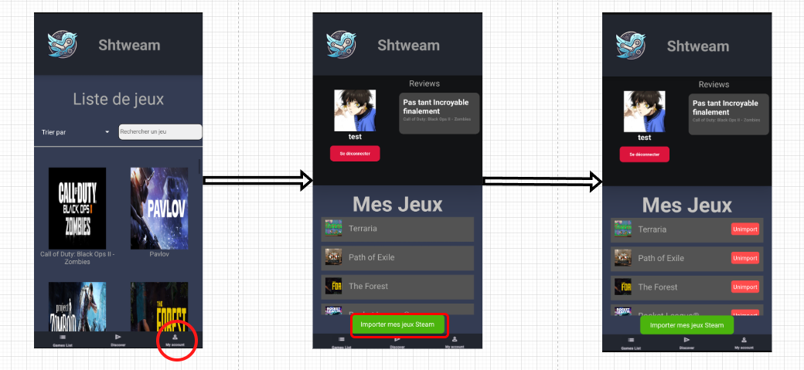
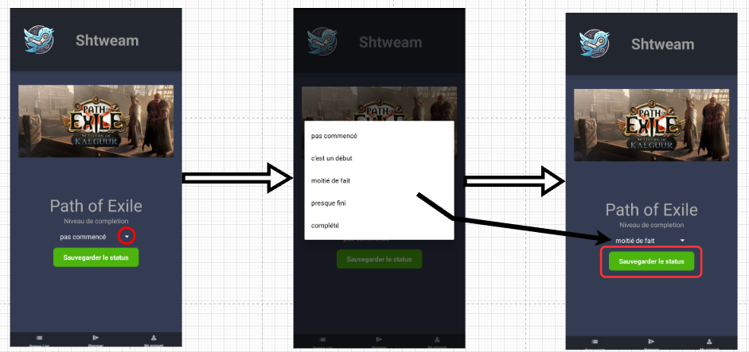
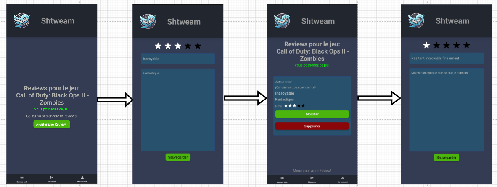

<p align="center">
  
</p>

<h1 align="center">Shtweam</h1>

<p align="center">
  Une application mobile pour importer sa bibliothèque Steam, suivre sa progression dans ses jeux et partager des critiques avec la communauté.
</p>

<p align="center">
  
  
  
  
</p>

---

> [!WARNING]
> **Projet archivé, application non fonctionnelle.** La base de données hébergée sur le serveur *Martha* du Cégep n'est plus active. La connexion, l'inscription et toutes les fonctionnalités qui en dépendent ne marchent donc plus. Le code reste disponible à titre de référence.

## À propos

**Shtweam** (Steam + Tweet) est un projet de fin de session en développement mobile. L'idée : un réseau social minimaliste autour des jeux vidéo, branché directement sur le compte Steam de l'utilisateur.

L'interface reprend la palette de couleurs de l'application mobile de Steam, avec un logo maison qui sert aussi de bouton retour sur chaque écran.

<p align="center">
  
</p>

## Fonctionnalités

- **Compte Shtweam lié à Steam** : inscription avec une clé d'API Steam et un Steam ID, validés auprès de l'API Steam. Un tutoriel intégré explique comment obtenir sa clé.
- **Importation de la bibliothèque** : les jeux possédés sur Steam sont importés en un clic, et peuvent être retirés (« Unimport »).
- **Liste de jeux** : recherche et tri alphabétique (croissant ou décroissant).
- **Suivi de progression** : choix du niveau de complétion pour chacun de ses jeux.
- **Reviews** : une critique par jeu possédé, avec titre, description et note de 1 à 5. Elle peut être modifiée ou supprimée.
- **Commentaires** : discussion sous chaque review, avec modification de ses propres commentaires.
- **Discover** : affiche la review d'un jeu choisi au hasard.

<p align="center">
  
  
</p>

## Stack technique

| Couche | Technologie |
|--------|-------------|
| Application | React Native 0.76, Expo SDK 52 |
| Navigation | React Navigation (native stack) |
| UI | `react-native-toast-message`, `@kolking/react-native-rating`, `@react-native-picker/picker` |
| Données de jeux | [Steam Web API](https://steamcommunity.com/dev) |
| Base de données | MySQL, exposée par l'API de requêtes *Martha* du Cégep de Shawinigan |

## Structure du projet

```
.
├── code/                    # Application Expo
│   ├── App.js               # Point d'entrée et définition de la navigation
│   ├── Views/               # Écrans (connexion, liste de jeux, reviews, profil…)
│   ├── Templates/           # Gabarit de base et barre de navigation
│   ├── Services/            # Appels à l'API Steam et à la base de données
│   ├── Models/              # Classes Game, Review, Comment, User
│   ├── authentification/    # Connexion, inscription, session
│   └── assets/              # Logo, images, police Righteous, styles
└── doc/                     # Documentation du projet
    ├── guide_utilisateur.md
    ├── guide_deploiement.md # Schéma SQL et données de départ
    ├── procedurier.md       # Comportement attendu de chaque écran
    ├── dev_standards.md
    └── rapport final.pdf
```

## Lancer le projet

**Prérequis :** [Node.js](https://nodejs.org/) et l'application [Expo Go](https://expo.dev/go) sur un téléphone, ou un émulateur Android/iOS.

```bash
cd code
npm install
npm start
```

Scanne ensuite le code QR avec Expo Go, ou appuie sur `a` (Android) ou `i` (iOS) dans le terminal.

> L'application démarre, mais elle ne peut pas aller plus loin que l'écran de connexion : la base de données *Martha* qu'elle utilisait n'est plus en ligne. Pour la faire fonctionner à nouveau, il faudrait la rebrancher sur une autre base MySQL avec une API équivalente. Le schéma et les requêtes sont décrits dans [`doc/guide_deploiement.md`](doc/guide_deploiement.md).

## Documentation

- [Guide d'utilisateur](doc/guide_utilisateur.md) : importer ses jeux, suivre sa progression, écrire une review.
- [Guide de déploiement](doc/guide_deploiement.md) : schéma de la base de données et données de test.
- [Procédurier](doc/procedurier.md) : chaque action possible par écran et son résultat.
- [Standards de développement](doc/dev_standards.md) : choix UI/UX et conventions de code.
- [Rapport final](doc/rapport%20final.pdf)


Projet réalisé dans le cadre du cours de développement mobile au Cégep de Shawinigan.
